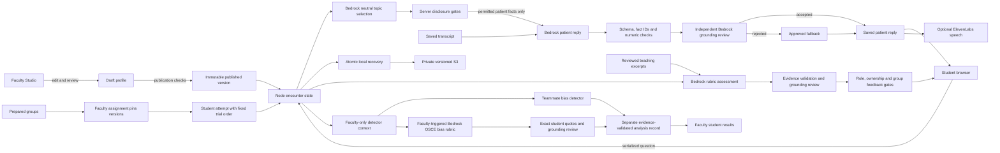

# Architecture

## Data boundaries

The entry picker selects a local Faculty/Student demo session. Server guards protect authoring, raw files, student ownership and faculty analysis. Students see only their encounters; group assessments are filtered from every student response/export until all trials finish. Faculty can inspect student attempts but cannot alter them. Aliases, prepared groups, assignments, attempts and separate analysis results share the existing local/S3 manifest. Sessions reset on restart; saved progress remains. See [comparison workflow](DEMO-GROUPS.md) and [detector contract](BIAS-INTEGRATION.md). This is intentionally a local demonstration identity system, not public-hosting authentication.

| Data                               | Source of authority                      | Model use                                                                         |
| ---------------------------------- | ---------------------------------------- | --------------------------------------------------------------------------------- |
| Patient name, age and identity     | Published faculty metadata               | Patient identity                                                                  |
| Patient facts and approved wording | Reviewed published profile               | Only selected, permitted facts enter reply generation                             |
| Hidden clinical values             | Backend profile snapshot                 | Excluded from topic selection and dialogue context until permitted                |
| Neutral topic descriptions         | Faculty-authored descriptors             | Semantic question matching; authors must avoid hidden values in these descriptors |
| History                            | Saved encounter turns                    | Conversational context; student statements remain untrusted claims                |
| Teaching excerpts                  | Explicitly selected reviewed sources     | Drafting support and assessment; not automatic patient facts                      |
| Student notes/SBAR                 | Student-authored claims                  | Evidence for assessment; never overwrite the patient                              |
| Development examples               | Six reviewed synthetic behavior examples | Inference-time demonstrations; no training or fine-tuning                         |

Profile `facts[]` is the authoritative authoring structure. Editable fields update that structure directly. Source content remains evidence, never an instruction source. Publications clone the profile; encounters clone their selected publication. Draft edits cannot alter an ongoing attempt.

Disclosure includes patient-known `ask` facts and chart-only `chart` facts. Trust gates apply to both. Reports can release by section, question keywords or either; a question-only report stays locked when its tab is opened. Every mapped fact must be permitted before its report releases. Releasing a report is distinct from explicitly recording that the student reviewed it.

## Dialogue workflow

1. The backend validates and serializes the question, deduplicating client request IDs.
2. An optional configured Bedrock Guardrail filters input. Explicit attacks are blocked locally too.
3. A semantic selector sees only neutral topic IDs/descriptions and the conversation. It does not receive hidden fact text or chart values.
4. The server applies disclosure conditions and selects approved deflections. The patient generator receives permitted patient wording, identity, style, recent history and behavior examples.
5. Returned JSON must have valid supporting IDs. Empty citations allow only an exact approved deflection or unknown response. New numeric values fail validation.
6. An independent model call checks every factual clause against supporting facts. Claims must cite existing IDs and quote actual approved wording; only typographic quotation/whitespace normalization is tolerated. A failure returns approved wording, never the rejected candidate. Neutral selector IDs are opaque aliases, so an authored ID cannot reveal a hidden value.
7. Stable events record actual patient replies, disclosure, release, review, provider, model, latency and fallback reason. Speech uses only those saved replies.

This is a bounded backend workflow, not an autonomous agent loop. A model-based reviewer can also make mistakes; the held-out suite and manual review remain necessary. The local fallback uses keyword matching and does not provide equivalent naturalness or semantic matching.

## Assessment and persistence

Seven domains use 1–4 or N/A, with denominator `4 × applicable domains`. N/A is selected by scenario authors, not inferred from a skipped action. Ratings of 1 in domains 6 or 7 require review. Faculty objectives and completion evidence remain separate. Positive ratings require existing evidence IDs; invented evidence and unsupported prose trigger a clearly labeled provisional local fallback. The total is a discussion aid.

Local snapshots use a serialized write queue and atomic rename. Cloud snapshots copy attachments before their manifest; immutable profile versions and completed encounters also have explicit paths. These are application-level immutable versions with S3 versioning, not S3 Object Lock. Recovery is explicit into a new directory.

## AWS services

Supported Claude models use fixed strict JSON schemas for grounding claims and rubric outputs, with additional runtime checks for evidence, applicability and disclosure. Schemas are shared across cases to reuse the AWS compilation cache. First compilation may take minutes; warm them before rehearsal. [AWS structured-output documentation](https://docs.aws.amazon.com/bedrock/latest/userguide/structured-output.html) describes supported models and schema restrictions. Nova uses prompted JSON and the same application validation.

Bedrock Converse uses configurable `us-west-2` or `us-east-1` access. Candidate model IDs are `us.anthropic.claude-sonnet-4-6` and `us.amazon.nova-2-lite-v1:0`. S3 stores source attachments, artifacts, versions and encounter recovery. Credentials are read only by the server and scripts through the AWS SDK credential provider chain.

Managed Knowledge Bases, Strands, AgentCore and fine-tuning are deferred. A larger reference corpus could justify retrieval; it must still distinguish teaching evidence from patient facts. Fine-tuning would require reviewed dialogue examples and a held-out validation set, not eight persona descriptions. AWS's contextual grounding check excludes conversational chatbot use cases, so this prototype retains its own validation and evaluations.

Official references: [Converse API](https://docs.aws.amazon.com/bedrock/latest/APIReference/API_runtime_Converse.html), [S3 bucket creation and security defaults](https://docs.aws.amazon.com/AmazonS3/latest/API/API_CreateBucket.html), [grounding limitations](https://docs.aws.amazon.com/bedrock/latest/userguide/guardrails-contextual-grounding-check.html), [model customization](https://docs.aws.amazon.com/en_en/bedrock/latest/userguide/custom-models.html).
